<div align="center">

# Open Film Skills｜AI 影视创作技能库

**从一个故事，到可读剧本、视觉资产、具体镜头和可观看的成片。**

为 AI 影视、短片与剧情视频创作者准备的独立 Agent Skills。按当前要解决的问题选一个入口，也可以把已确认的创作决定沿流程交给下一阶段。

**21 个独立源码包 · 18 项常规 + 3 项实验 · 42 份中英说明**

[全部技能](#skills) · [完整工作流程](#workflow) · [功能与作品](#features) · [安装与调用](#install) · [证据与边界](#evidence) · [版本更新](#updates)

**简体中文** · [English](#english-overview) · [日本語](docs/i18n/ja/README.md) · [한국어](docs/i18n/ko/README.md)


[](https://github.com/62656456/ai-film-skills/actions/workflows/validate.yml)
[](https://skills.sh/62656456/ai-film-skills)
[](LICENSE)

</div>

<a id="overview"></a>

## 这套技能解决什么问题

你可以拿着点子、小说、剧本、参考图或已经确定的镜头开始。这里把创作工作分成可以单独使用、也能相互交接的职责：

- **故事与导演**：把人物目的、行动、对白和场景因果写成可读剧本，再确定表演、视觉、声音与剪辑方向。
- **视觉与资产**：选择与故事相称的视觉语言，设计能反复使用的人物、场景和道具，保住身份、空间与状态。
- **分镜与摄影**：决定观众先看什么、从哪里看、看多近，安排调度、机位、光色、运镜、节奏与切点。
- **提示词与制作**：保留已选镜头，编译生成提示词；明确进入实际制作后，组织生成、选片、剪辑、声音与完整看片修复。
- **研究与辅助**：按需研究市场、审核知识写入、检查 3D 机位与走位，或设计创作工具的界面。

**已有材料直接接续。** 只改对白，就交对白修改；只要分镜，就交分镜；已有批准的导演方案或资产，就继承它们。每次交付都以本次请求为准。

这里的 Skill 是给宿主代理读取和执行的创作指令包，**不内置视频模型、账户、额度或全部制作软件**。实际图片、视频与预演需要宿主具备相应工具和执行条件。

<a id="skills"></a>

## 全部 21 个技能：什么时候用，拿到什么

下列 18 项常规包和 3 项实验包都在仓库中。每一项均可单独选择，链接直接打开对应中文说明；[完整源码与版本目录](SKILL_CATALOG.md)和[英文说明](docs/skills/INDEX.md)另列。

### 编剧与导演 · 2 项

| 技能 | 什么时候用 | 直接交付什么 |
|---|---|---|
| [编剧与导演](docs/skills/zh-CN/director-agent.md)<br/>`director-agent` | 从点子或小说写剧本，修改场景与对白，诊断人物行动和因果；分镜前需要导演判断 | 可读剧本、替换段落、诊断或导演方案；明确需要时另编译 AI 执行剧本 |
| [分镜与摄影](docs/skills/zh-CN/ai-storyboard-director.md)<br/>`ai-storyboard-director` | 已有故事或导演方案，需要决定观看顺序、人物调度、摄影、时间和连续性 | 创意拍法备选、可读分镜或一条六模块视频母提示词；按需查询 FCML，并保存恢复已选镜头决定 |

### 人物、场景与道具资产 · 3 项

| 技能 | 什么时候用 | 直接交付什么 |
|---|---|---|
| [人物资产](docs/skills/zh-CN/character-asset.md)<br/>`character-asset` | 确定人物身份、外形、服装及允许变化，让后续镜头有一致的人物依据 | 正面、90°侧面、背面全身加中景的参考任务或提示词，以及身份、视图与状态合同；按请求和工具条件生成参考图，普通肖像按点名范围处理 |
| [场景资产](docs/skills/zh-CN/scene-asset.md)<br/>`scene-asset` | 设计空间布局、出入口、地标、光源与材质，建立能承载镜头的环境 | 默认主图 + 独立反打图的设计或提示词与空间合同；按请求交实际图，或扩展同空间多机位、九宫格 |
| [道具资产](docs/skills/zh-CN/prop-asset.md)<br/>`prop-asset` | 设计道具整体形制、比例、结构、材质、持用和变化状态 | 整体与必要结构细节的参考任务、提示词及道具合同；按请求和工具条件生成参考图，视图由实际设计问题决定 |

### 类型视觉与美术 · 8 项

这些技能把题材要求落实到光色、空间、材质、构图和动作。它们服务于已有故事、资产与镜头，输出当前任务需要的视觉方案或提示词参数；实际出图按请求和工具条件进入。

| 技能 | 适用的视觉问题 | 主要处理与交付 |
|---|---|---|
| [赛博朋克](docs/skills/zh-CN/cyberpunk-design.md)<br/>`cyberpunk-design` | 身体与技术、义体、未来社会空间 | 功能光源、空间层级、材质、人物处境与连续性的视觉设计和提示词要求 |
| [史诗](docs/skills/zh-CN/epic-design.md)<br/>`epic-design` | 群体、建筑、地形和个人命运共同形成的宏大尺度 | 人物参照、阵列、纵深、奇观层次、光色及运动参数 |
| [奇幻](docs/skills/zh-CN/fantasy-design.md)<br/>`fantasy-design` | 魔法、生物、森林与城堡等自洽的异世界 | 世界规则、魔法来源与作用目标、环境反馈、材料与光源的视觉设计和提示词参数 |
| [恐怖](docs/skills/zh-CN/horror-design.md)<br/>`horror-design` | 威胁在哪里、何时显露，暗部如何仍可辨认 | 异常痕迹、空间不安、显露顺序、可读暗部及声音和连续性要求 |
| [黑色与犯罪](docs/skills/zh-CN/noir-design.md)<br/>`noir-design` | 秘密、交易、侦查与人物权力关系 | 明暗信息、遮挡、有来源的实用光、空间关系和材质的视觉方案与提示词 |
| [爱情](docs/skills/zh-CN/romance-design.md)<br/>`romance-design` | 用距离、视线、接触和双向行动表现关系 | 亲密关系的视觉方案、光影材质参数和提示词；配色服从具体人物关系 |
| [战争与军事视觉](docs/skills/zh-CN/war-design.md)<br/>`war-design` | 军事人物装备、场景道具、战斗与小队画面 | 军事视觉顾问设计、完整图像提示词、按请求生成的实际图片与画面审查；为已定镜头补充视觉和声音要求 |
| [武侠](docs/skills/zh-CN/wuxia-design.md)<br/>`wuxia-design` | 兵器、步法、支撑、发力及东方空间 | 兵器路径、接触反应、衣发反馈、材质和动作节奏的视觉设计与提示词参数 |

### 制作与短剧控制 · 2 项

| 技能 | 什么时候用 | 直接交付什么 |
|---|---|---|
| [实际视频生产](docs/skills/zh-CN/produce-ai-video.md)<br/>`produce-ai-video` | 明确要实际视频、真实单镜测试或最终成片 | 统筹生成、选片、剪辑、对白音效、完整播放与修复；工具和授权齐全时交可播放媒体 |
| [短剧生产控制](docs/skills/zh-CN/ai-short-drama-production.md)<br/>`ai-short-drama-production` | 已有短剧创作决定，需要把生产信息接起来、补齐缺口 | 节拍合同、资产索引、调度图、布光图、动作账本、草图转镜头说明；按请求交五列分镜或六模块母提示词。常规分发，独立合同已提供；实片效果待验，宿主启用需实际安装确认 |

### 研究与知识审核 · 2 项

| 技能 | 什么时候用 | 直接交付什么 |
|---|---|---|
| [官方来源市场研究](docs/skills/zh-CN/d-official-market-analysis.md)<br/>`d-official-market-analysis` | 判断题材、平台、受众或制作机会，需要可复核资料 | 有日期、口径、来源和局限的分析报告、证据表及单独标记的知识候选 |
| [知识审核与写入](docs/skills/zh-CN/d-data-analysis-semantic-layer.md)<br/>`d-data-analysis-semantic-layer` | 用户看过报告和候选后，明确批准写入指定知识目标 | 核对来源、版本、有效期和冲突，完成写入与回读；条件不足时交清楚标记的待写入包 |

### 网页与创作工具界面 · 1 项

| 技能 | 什么时候用 | 直接交付什么 |
|---|---|---|
| [网页与界面设计](docs/skills/zh-CN/web-design-director.md)<br/>`web-design-director` | 明确需要作品站、资产库、审核台、工作台或应用界面 | 界面方向、带证据的审查，或具备代码、运行和浏览器验证的实现 |

### 实验包 · 3 项

实验包另行选择安装，具体能力和验证范围写在各包说明中。

| 技能 | 什么时候用 | 直接交付什么 |
|---|---|---|
| [硬科幻视觉](docs/skills/zh-CN/hard-sci-fi-visual-director.md)<br/>`hard-sci-fi-visual-director` | 需要物理、功能、制造与环境依据的原创硬科幻世界和资产 | 视觉推导、设计方案、视觉/资产圣经、完整提示词或诊断；已有接受图例，其他任务效果分别核验 |
| [3D 白模预演](docs/skills/zh-CN/whitebox-previs-executor.md)<br/>`whitebox-previs-executor` | 已有镜头，要检查真实 3D 机位、视差、基础走位或已支持的短动作 | 运行条件齐全时交可播放 MP4、编译与验证记录，可选工程；打斗限定已实现代理和已通过动作门的规格 |
| [古风视觉](docs/skills/zh-CN/guofeng-visual-director.md)<br/>`guofeng-visual-director` | 设计古风人物服饰、建筑器物、生活空间和光色 | 完整视觉方案、图像提示词、受控变体或诊断；区分历史还原、架空和风格化，当前为 0.1.1 实验候选 |

**外部仙侠入口**：[xianxia-visual-director](https://github.com/liyue-aigc/xianxia-visual-director)用于仙侠世界、天宫巨构与写实摄影。本仓库只链接上游，不分发它的源码或 ZIP。它不计入上述 21 个包和 42 份指南；仓库本身是 **20 项影视相关技能 + 1 项网页辅助技能**。

<a id="workflow"></a>
<a id="从输入到成片完整工作流"></a>

## 怎样配合：把已确认的决定交给下一步

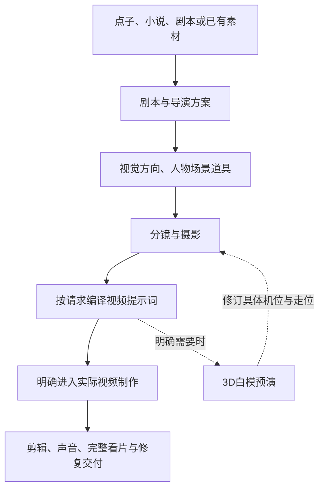

| 当前阶段 | 接收什么 | 留给下一步什么 |
|---|---|---|
| 剧本与导演 | 点子、原文、已有剧本、当前要求与锁定项 | 可读剧本、人物行动、表演、视觉和声音方向 |
| 类型视觉与资产 | 剧情、导演方向与已有参考 | 已选视觉语言；人物身份、空间布局、道具状态和参考图职责 |
| 分镜与摄影 | 可用导演方案、资产与前后状态 | 观看顺序、具体画框、人物调度、机位光学、运动、节奏与切点 |
| 提示词编译 | 已选镜头、原台词、时长、参考与保留项 | 完整六模块母提示词，保全已确定的摄影与动作 |
| 可选白模 | 明确的 3D 预演请求与已写好的镜头 | 可播放机位/走位检查；不成立处回到具体镜头修订 |
| 实际制作与后期 | 明确的视频请求、已选材料、可用工具与授权 | 真实素材、选片、剪辑、声音、完整播放检查与返修结果 |

已有剧本可以直接进入导演或资产阶段；已有导演方案可以直接做分镜；已有分镜可以直接编译提示词。**创意思路、分镜、提示词、实际生成分别进入，不自动升级阶段。** 重要创意先作为备选，采用后才写入正式镜头。

短剧控制技能把已有决定组织成生产合同；市场研究先交报告和候选，知识写入等待明确批准；网页技能在有独立界面任务时使用。[各阶段的完整职责与返回关系](docs/WORKFLOW.md)

<a id="features"></a>

## 功能怎样落到实际创作里

### 把故事写成行动，再让画面承担信息

导演 Agent 处理人物为什么行动、对白改变什么、场景怎样把状态传到下一场。分镜导演处理观众从哪里看、先知道什么、何时看见关键变化。已有的表演、情绪或镜头被认可后，局部改稿继续保留它们。

当前分镜 5.8.3 先比较同剧情下的起点、转折和终点：对象在框内多大，哪些关系同时可见，空区和遮挡怎样影响信息。选定观看方案后，才安排摄影机制；包内 **115 个 FCML 机制**用于按需检索与绑定，不代替创作选择。

### 让人物、场景、道具在不同镜头中仍属于同一个世界

人物参考保留身份和服装；场景参考保留布局、出入口、光源与材料；道具参考保留结构、持用和状态。分镜接收这些决定，再推导当前机位看到的左右、纵深、遮挡与受光。美术参考、风格参考、指定首帧和末帧各自承担明确职责。

### 把电影质感写成能观察的选择

光色、材质、取景和运动在设计阶段共同决定，再进入分镜和提示词。手持写出晃动由何产生、怎样变化与收稳；人物速度、摄影机速度、播放速度和剪辑密度分别组织。打戏保留应答、接触、持物、支撑和共同空间，实际光形来自同一世界中的光源、遮挡和反射。

### 从文字进入实际媒体，用可播放结果检查

视频生产技能继承已选方案，组织实际生成与后期。白模用于明确范围内的机位、视差、走位或已实现动作检查；视频制作还要看完整动作、声音和前后连续。失败时修复最早失效的故事、资产、摄影或执行环节，继续保留有效内容。

<a id="gallery"></a>

## 已有作品与研究：原图、原视频和状态都能查看

下面是已有成果的代表图，点击查看完整原图。它们分别属于对应的历史批次，保留原接受范围；静帧和界面截图不承担视频执行或全库稳定性的证明。

<table>
<tr>
<td width="50%" valign="top"><a href="docs/showcase/originals/noir-before-the-money.png">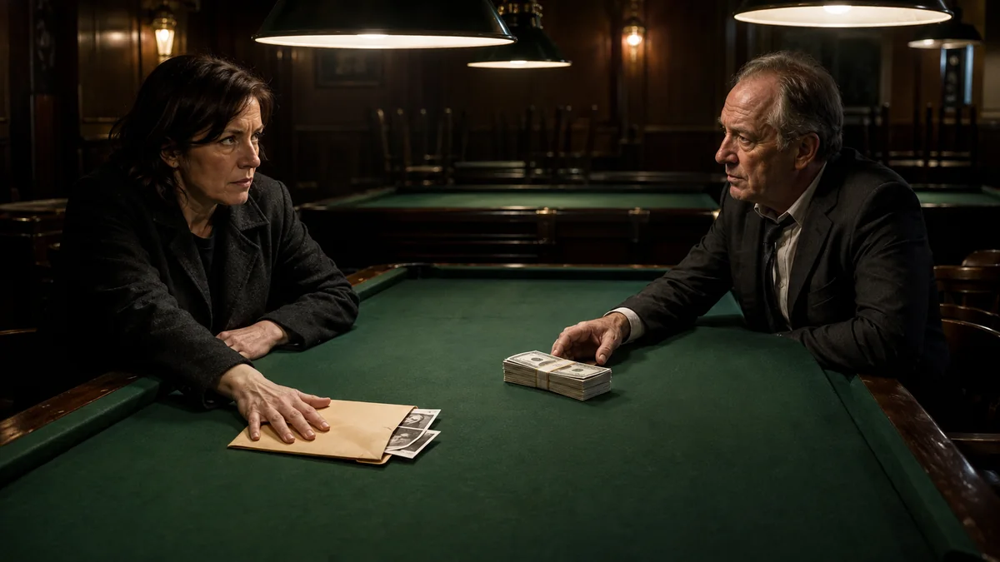</a><br/><strong>类型视觉与人物关系 ·《收钱之前》</strong></td>
<td width="50%" valign="top"><a href="docs/showcase/originals/war-bold-floodgate-blue.png">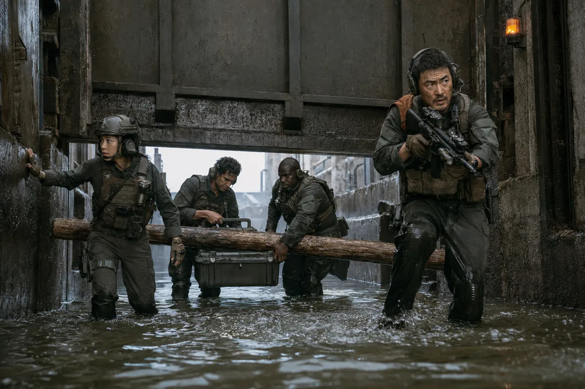</a><br/><strong>战争与小队画面 ·《潮门幽蓝》</strong></td>
</tr>
<tr>
<td width="50%" valign="top"><a href="docs/showcase/originals/hard-scifi-orbital-morning.png"></a><br/><strong>硬科幻世界与生活 ·《环城清晨》</strong></td>
<td width="50%" valign="top"><a href="docs/showcase/originals/web-design-lumen-desktop-confirmed.png"></a><br/><strong>网页辅助 · LUMEN 界面</strong></td>
</tr>
</table>

<a id="本轮21张用户接受视觉成果"></a>

### 已接受的视觉与界面作品

历史展示共 21 张：19 张原创生成静帧、2 张原创界面截图。全部原图、来源与对应的用户接受记录保留在下面的完整展示中。

<details>
<summary>展开历史21张作品：19张原创静帧与2张LUMEN界面截图</summary>

以下历史19张是原创生成静帧，另有2张是原创LUMEN界面的真实浏览器截图；用户均已逐批明确接受。预览保持原始比例，点击进入原始PNG，没有裁切成卡片来隐藏边缘。仙侠技能本体来自外部，仅链接上游，图是原展示批次授权生成的原创成果。

<table>
<tr>
<td width="50%" valign="top"><a href="docs/showcase/originals/cyberpunk-after-the-new-eye.png">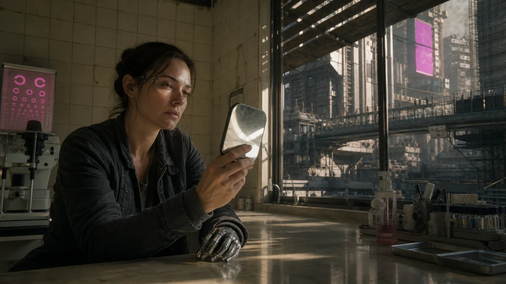</a><br /><strong>《换眼之后》</strong><br />赛博朋克：身体、技术与人的处境。</td>
<td width="50%" valign="top"><a href="docs/showcase/originals/epic-open-gates.png">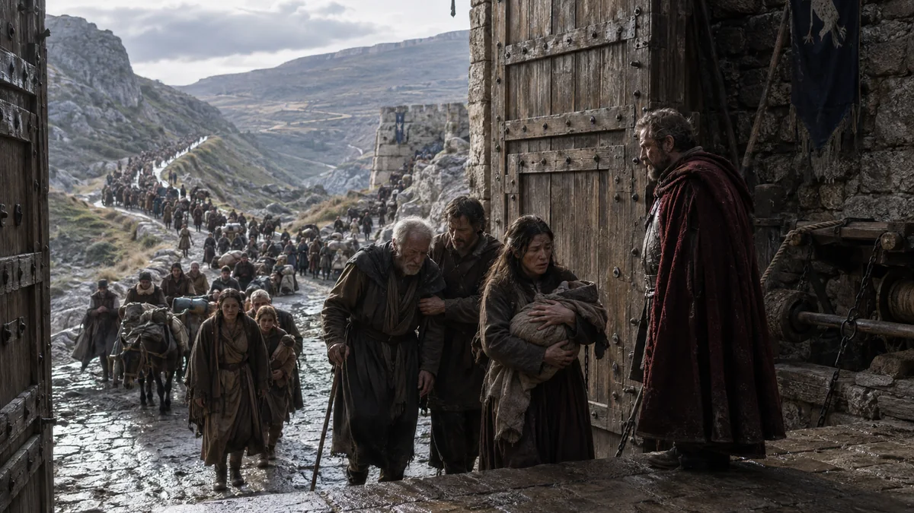</a><br /><strong>《开门》</strong><br />史诗：群体规模与门前的个人命运。</td>
</tr>
<tr>
<td width="50%" valign="top"><a href="docs/showcase/originals/fantasy-mending-the-bridge.png">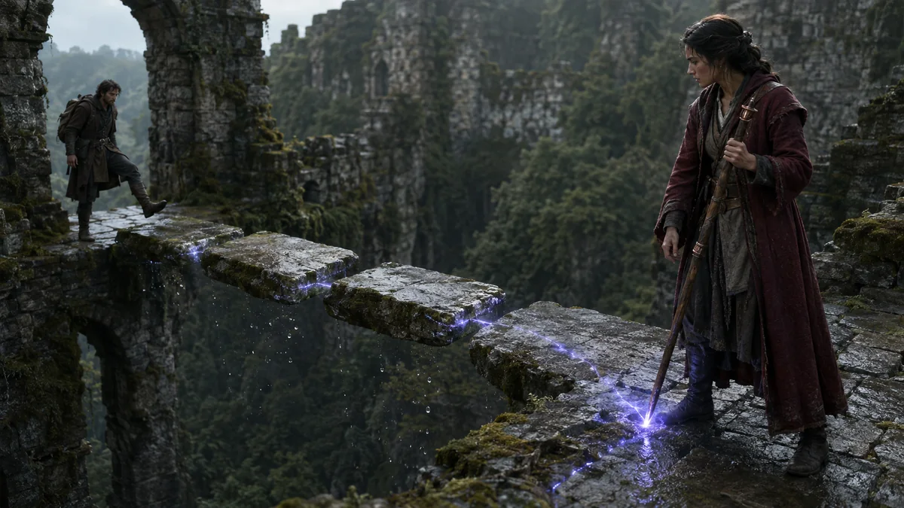</a><br /><strong>《重续断桥》</strong><br />奇幻：魔法作用、石桥与跨越。</td>
<td width="50%" valign="top"><a href="docs/showcase/originals/horror-upstairs-visitor.png">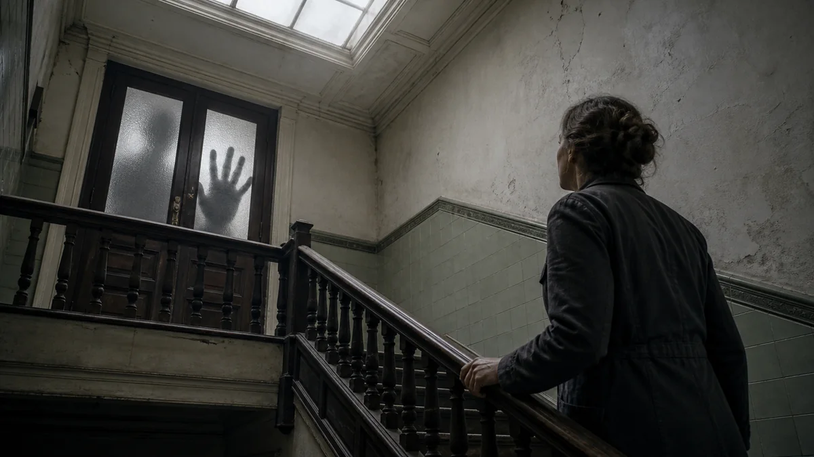</a><br /><strong>《楼上的访客》</strong><br />恐怖：可读空间中的异常证据。</td>
</tr>
<tr>
<td width="50%" valign="top"><a href="docs/showcase/originals/noir-before-the-money.png"></a><br /><strong>《收钱之前》</strong><br />黑色：证据、封口费与未完成交易。</td>
<td width="50%" valign="top"><a href="docs/showcase/originals/romance-tilted-umbrella.png">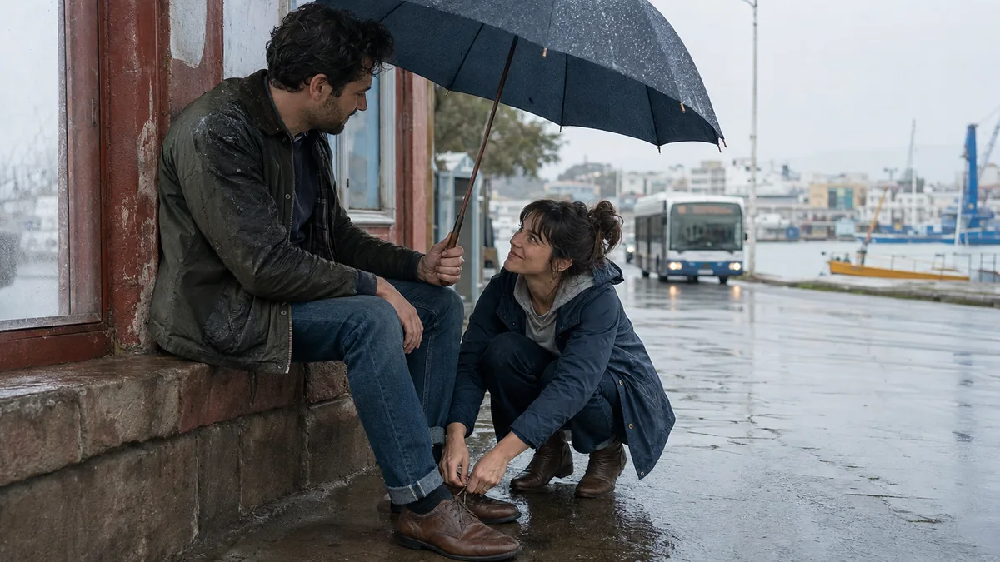</a><br /><strong>《把伞偏过去》</strong><br />爱情：系鞋与偏伞的双向照顾。</td>
</tr>
<tr>
<td width="50%" valign="top"><a href="docs/showcase/originals/war-river-crossing.png">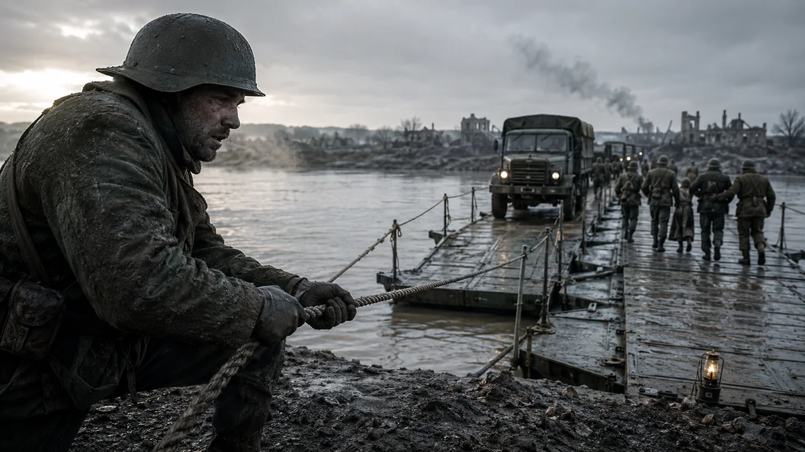</a><br /><strong>《渡河》</strong><br />战争：负荷、协同与渡河行动。</td>
<td width="50%" valign="top"><a href="docs/showcase/originals/wuxia-tea-still-warm.png">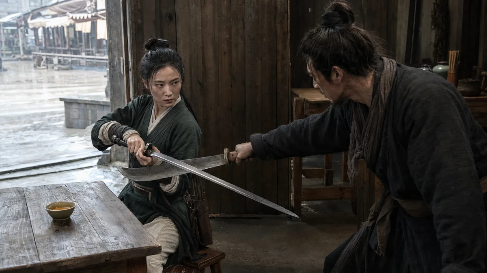</a><br /><strong>《茶未凉》</strong><br />武侠：日常空间中的兵器与关系压力。</td>
</tr>
<tr>
<td width="50%" valign="top"><a href="docs/showcase/originals/hard-scifi-orbital-morning.png"></a><br /><strong>《环城清晨》</strong><br />硬科幻：轨道生活与细小照料。</td>
<td width="50%" valign="top"><a href="docs/showcase/originals/hard-scifi-lunar-lightfield.png">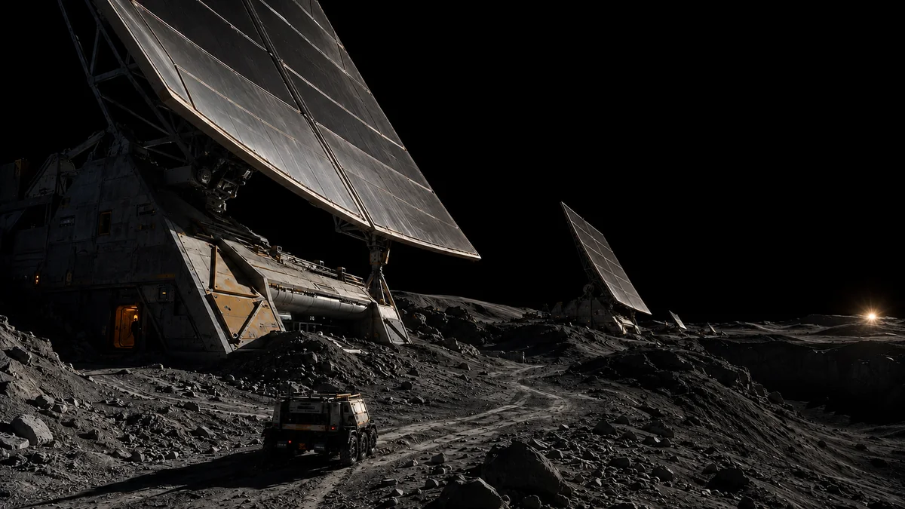</a><br /><strong>《极昼镜阵》</strong><br />硬科幻：月面系统、尺度与日照。</td>
</tr>
<tr>
<td width="50%" valign="top"><a href="docs/showcase/originals/hard-scifi-titan-harbor.png">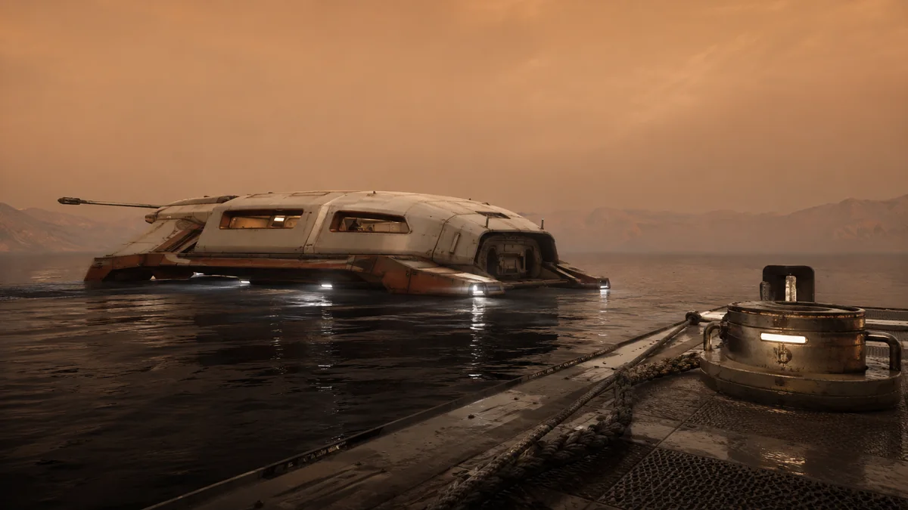</a><br /><strong>《泰坦泊岸》</strong><br />硬科幻：环境与装备形态。</td>
<td width="50%" valign="top"><a href="docs/showcase/originals/hard-scifi-mars-first-harvest.png">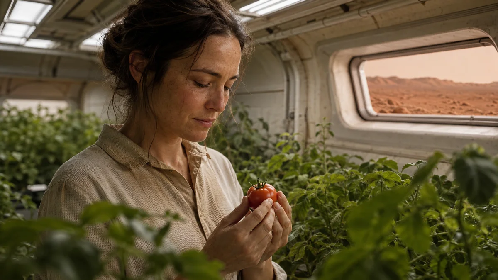</a><br /><strong>《火星的第一颗番茄》</strong><br />硬科幻：农业系统与收获。</td>
</tr>
<tr>
<td width="50%" valign="top"><a href="docs/showcase/originals/hard-scifi-europa-underice.png">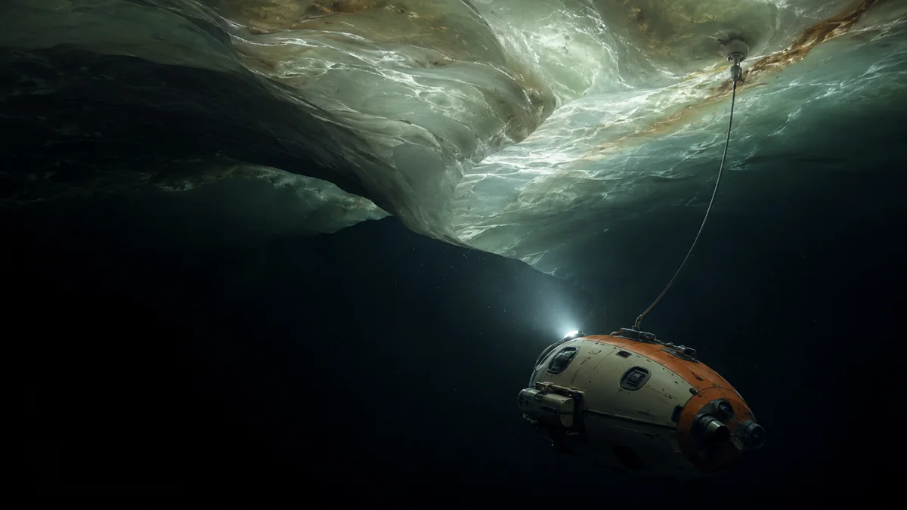</a><br /><strong>《冰壳下的来客》</strong><br />硬科幻：冰下环境与探测。</td>
<td width="50%" valign="top"><a href="docs/showcase/originals/xianxia-cloud-bell.png"></a><br /><strong>《云海钟境》</strong><br />仙侠：外部技能路线的原创成图。</td>
</tr>
<tr>
<td width="50%" valign="top"><a href="docs/showcase/originals/war-bold-black-shadow-advance.png">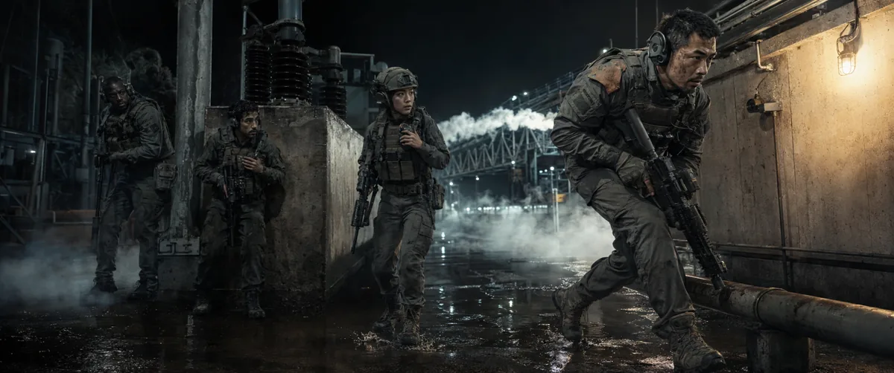</a><br /><strong>《黑影前行》</strong><br />贴地广角、实用光源和四人差异化动作。</td>
<td width="50%" valign="top"><a href="docs/showcase/originals/war-bold-suspended-city-landing.png">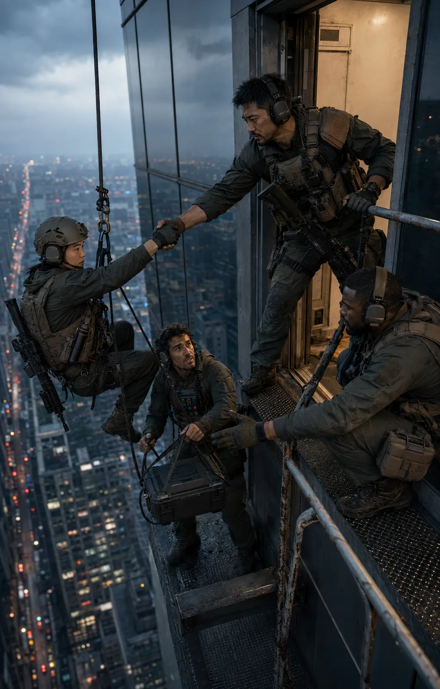</a><br /><strong>《悬城落点》</strong><br />高差、绳索承托、器材负荷和协作关系。</td>
</tr>
<tr>
<td width="50%" valign="top"><a href="docs/showcase/originals/war-bold-red-sand-contact.png">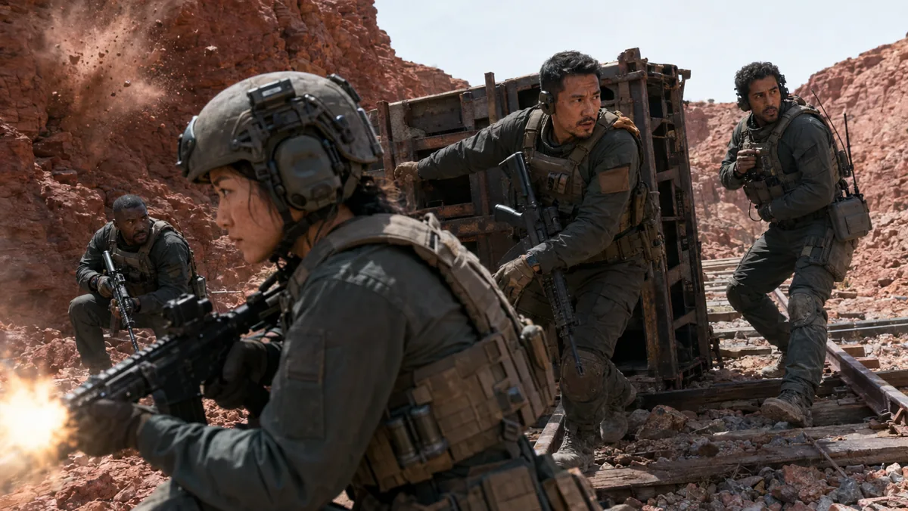</a><br /><strong>《赤沙交锋》</strong><br />过肩近景、局部碎屑和不同步的队员反应。</td>
<td width="50%" valign="top"><a href="docs/showcase/originals/war-bold-floodgate-blue.png"></a><br /><strong>《潮门幽蓝》</strong><br />水阻、低矮障碍、共同承重和警戒分工。</td>
</tr>
<tr>
<td width="50%" valign="top"><a href="docs/showcase/originals/war-bold-snowline-backlight.png">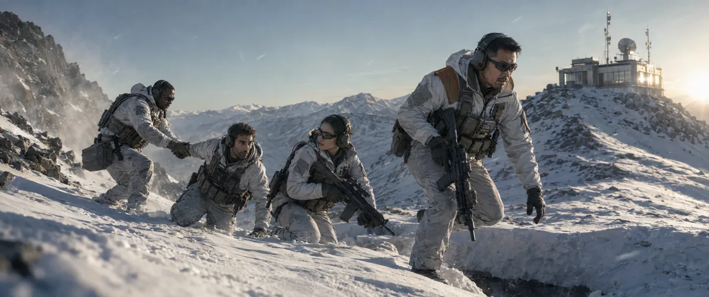</a><br /><strong>《雪线逆光》</strong><br />雪地阻力、错落队形、援手和明确目的地。</td>
<td width="50%" valign="top"><a href="docs/showcase/originals/web-design-lumen-desktop-confirmed.png"></a><br /><strong>LUMEN·桌面端</strong><br />收藏结果、再次回访入口和本地保存边界同时可见。</td>
</tr>
<tr>
<td width="50%" valign="top"><a href="docs/showcase/originals/web-design-lumen-mobile-favorites.png"></a><br /><strong>LUMEN·手机端</strong><br />390像素宽度下保留收藏、身份和回访路径。</td>
</tr>
</table>

[查看逐文件来源、版本、哈希与接受记录](docs/showcase/manifest.json)。这21张证明对应静帧或界面结果已通过用户审阅；五张战争小队图来自一次接受批次，两张LUMEN截图来自一次接受的界面交付，不能据此宣称跨任务稳定、真人可用性研究、所有题材成功或视频执行通过。

</details>

<details>
<summary>展开分镜研究：七题材21张首轮图、融合与逐图问题</summary>

### 七题材、三版本的分镜研究

七个全新原创故事分别交给测试时默认5.6.5、A5.7.1、B5.7.1-jev独立设计，得到 **21套30秒分镜、149个镜头和21张实际分镜图**。题材涵盖悬疑、恐怖、爱情、近身打戏、枪战、赛车追逐与超能力动作。

**这批是首轮测试图，尚未获得整批审美通过。** 逐图检查记录中，15张存在明确或限定范围的待修观察，共29条；其余6张本轮未发现足以确认的硬冲突，也不因此记为通过。换手、道具状态、人物复制、破损位置与空间关系等问题和原图一起保留。

[按题材切换查看高清三版对照](docs/research/skill-overhaul/seven-genres/viewer.html) · [全部原图、故事、分镜、生成提示词与逐图问题](docs/research/skill-overhaul/seven-genres/index.md)

<table>
<tr><th colspan="3">悬疑 ·《背过身的镜子》</th></tr>
<tr>
<td width="33%" valign="top"><a href="docs/research/skill-overhaul/seven-genres/images/01-suspense-current.png"></a><br/><strong>测试时默认 5.6.5</strong></td>
<td width="33%" valign="top"><a href="docs/research/skill-overhaul/seven-genres/images/01-suspense-a.png"></a><br/><strong>A 5.7.1</strong></td>
<td width="33%" valign="top"><a href="docs/research/skill-overhaul/seven-genres/images/01-suspense-b.png"></a><br/><strong>B 5.7.1-jev</strong></td>
</tr>
<tr><th colspan="3">恐怖 ·《最后一排床单》</th></tr>
<tr>
<td width="33%" valign="top"><a href="docs/research/skill-overhaul/seven-genres/images/02-horror-current.png">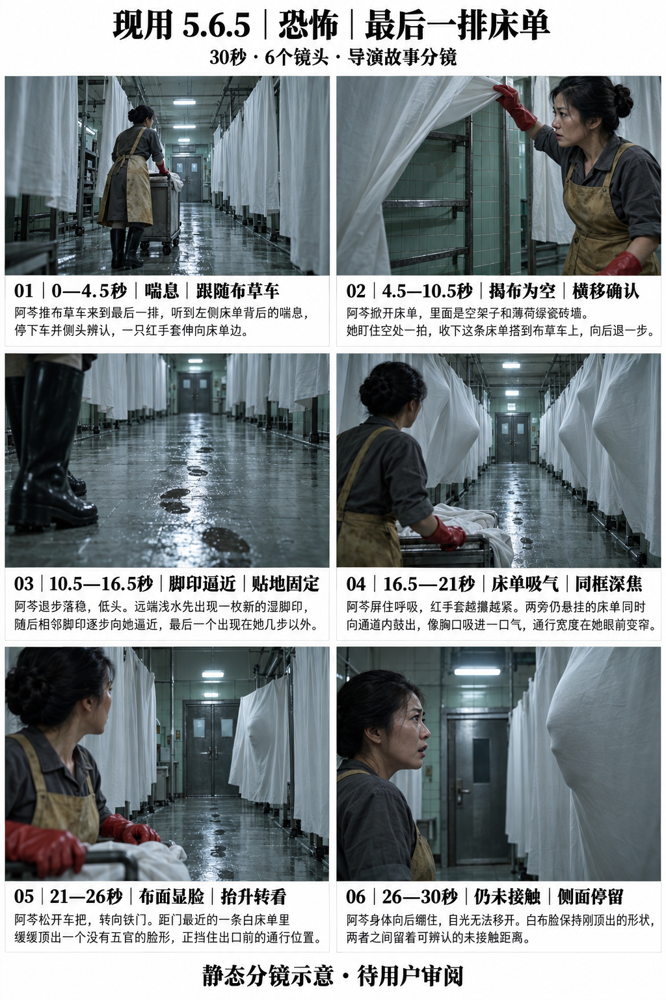</a><br/><strong>测试时默认 5.6.5</strong></td>
<td width="33%" valign="top"><a href="docs/research/skill-overhaul/seven-genres/images/02-horror-a.png">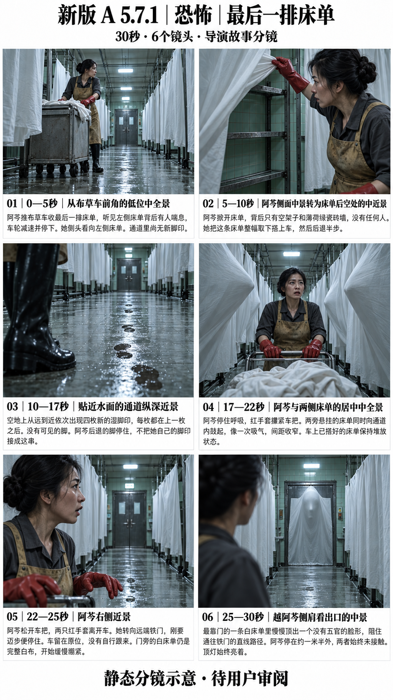</a><br/><strong>A 5.7.1</strong></td>
<td width="33%" valign="top"><a href="docs/research/skill-overhaul/seven-genres/images/02-horror-b.png">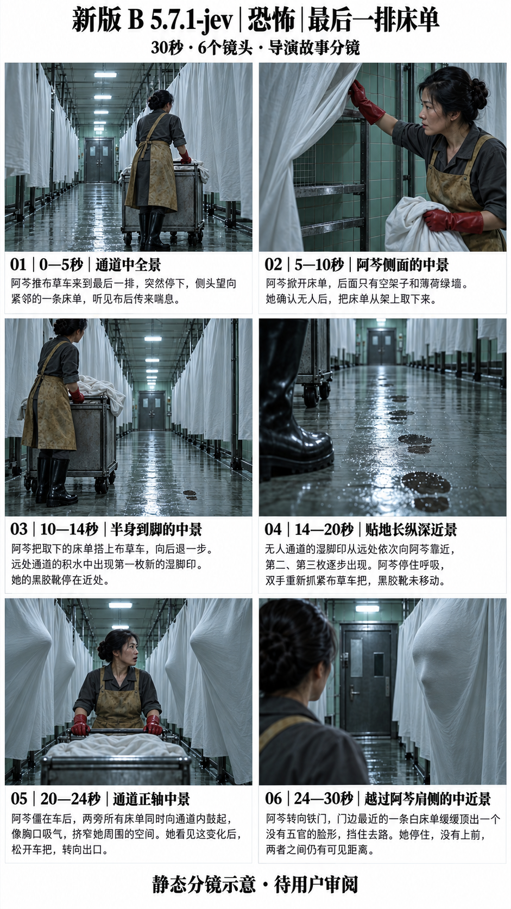</a><br/><strong>B 5.7.1-jev</strong></td>
</tr>
<tr><th colspan="3">爱情 ·《下一班也可以》</th></tr>
<tr>
<td width="33%" valign="top"><a href="docs/research/skill-overhaul/seven-genres/images/03-romance-current.png">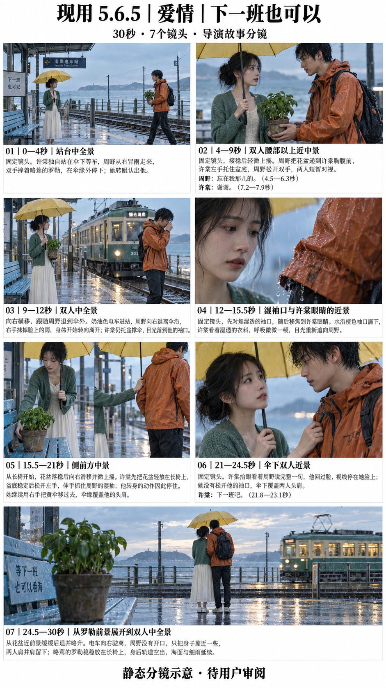</a><br/><strong>测试时默认 5.6.5</strong></td>
<td width="33%" valign="top"><a href="docs/research/skill-overhaul/seven-genres/images/03-romance-a.png">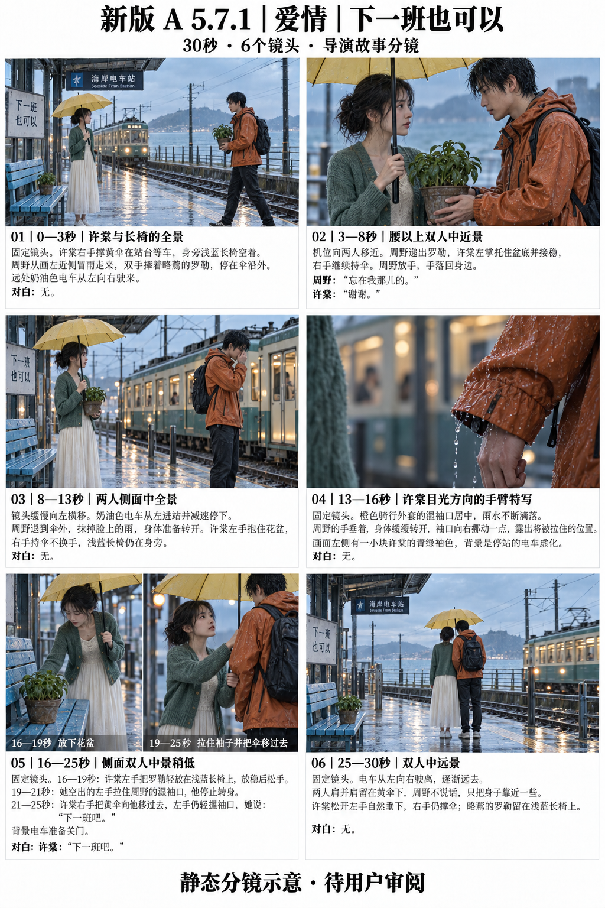</a><br/><strong>A 5.7.1</strong></td>
<td width="33%" valign="top"><a href="docs/research/skill-overhaul/seven-genres/images/03-romance-b.png">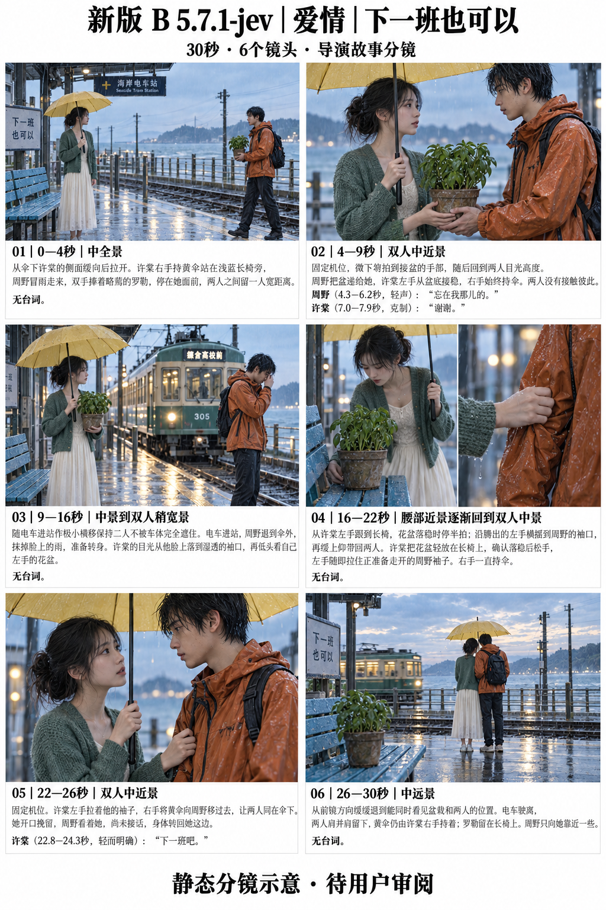</a><br/><strong>B 5.7.1-jev</strong></td>
</tr>
<tr><th colspan="3">近身打戏 ·《桥上只过一个人》</th></tr>
<tr>
<td width="33%" valign="top"><a href="docs/research/skill-overhaul/seven-genres/images/04-fight-current.png">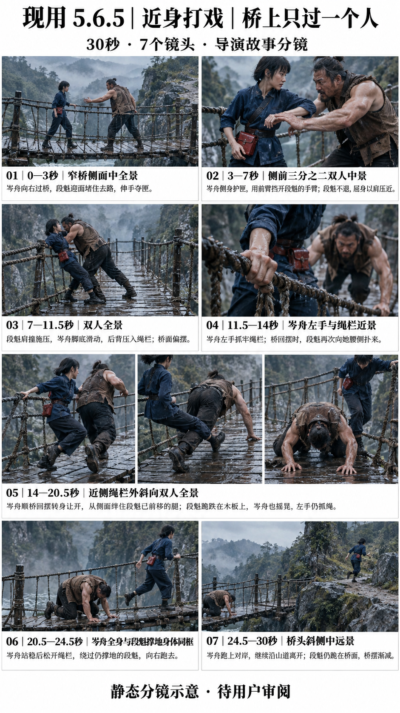</a><br/><strong>测试时默认 5.6.5</strong></td>
<td width="33%" valign="top"><a href="docs/research/skill-overhaul/seven-genres/images/04-fight-a.png">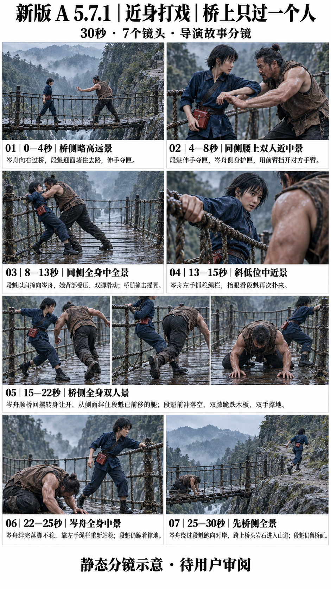</a><br/><strong>A 5.7.1</strong></td>
<td width="33%" valign="top"><a href="docs/research/skill-overhaul/seven-genres/images/04-fight-b.png"></a><br/><strong>B 5.7.1-jev</strong></td>
</tr>
<tr><th colspan="3">枪战 ·《关门之前》</th></tr>
<tr>
<td width="33%" valign="top"><a href="docs/research/skill-overhaul/seven-genres/images/05-gunfight-current.png">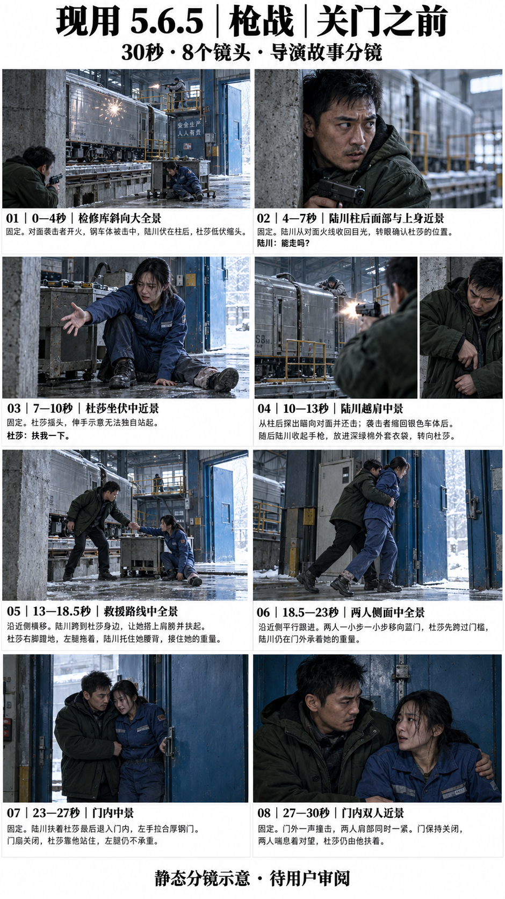</a><br/><strong>测试时默认 5.6.5</strong></td>
<td width="33%" valign="top"><a href="docs/research/skill-overhaul/seven-genres/images/05-gunfight-a.png">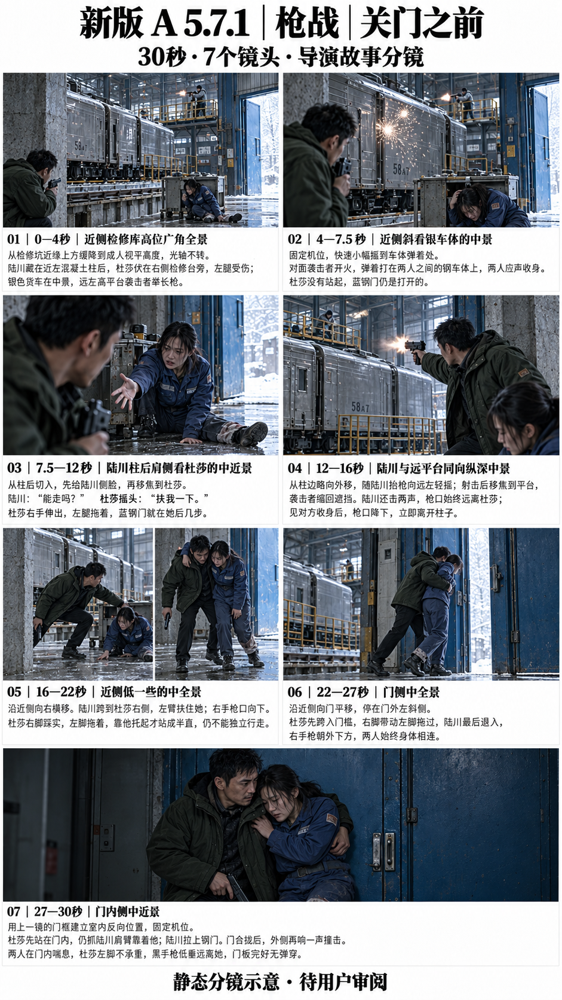</a><br/><strong>A 5.7.1</strong></td>
<td width="33%" valign="top"><a href="docs/research/skill-overhaul/seven-genres/images/05-gunfight-b.png">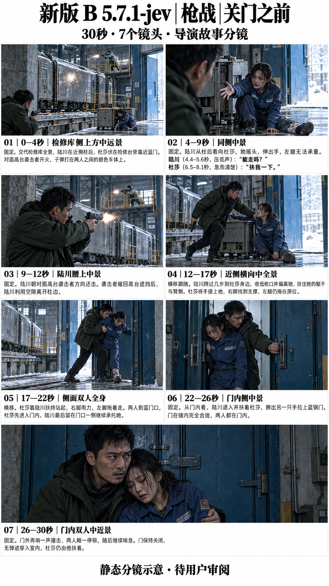</a><br/><strong>B 5.7.1-jev</strong></td>
</tr>
<tr><th colspan="3">赛车追逐 ·《松开的油门》</th></tr>
<tr>
<td width="33%" valign="top"><a href="docs/research/skill-overhaul/seven-genres/images/06-racing-current.png">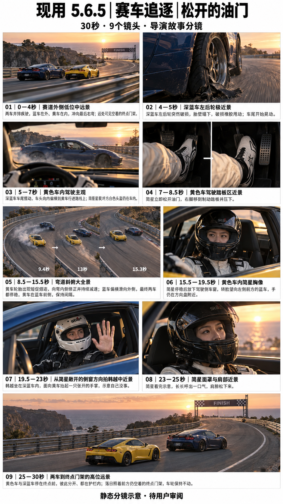</a><br/><strong>测试时默认 5.6.5</strong></td>
<td width="33%" valign="top"><a href="docs/research/skill-overhaul/seven-genres/images/06-racing-a.png">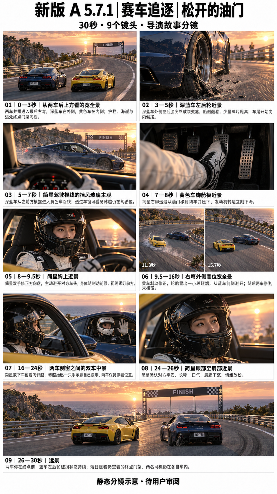</a><br/><strong>A 5.7.1</strong></td>
<td width="33%" valign="top"><a href="docs/research/skill-overhaul/seven-genres/images/06-racing-b.png">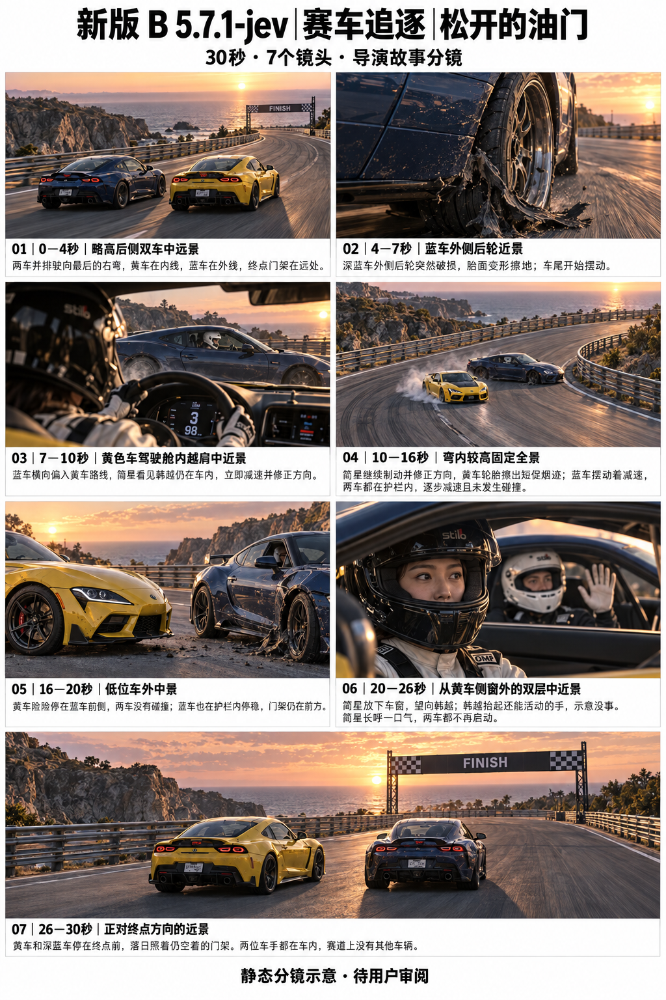</a><br/><strong>B 5.7.1-jev</strong></td>
</tr>
<tr><th colspan="3">超能力动作 ·《逆坠》</th></tr>
<tr>
<td width="33%" valign="top"><a href="docs/research/skill-overhaul/seven-genres/images/07-superpower-current.png">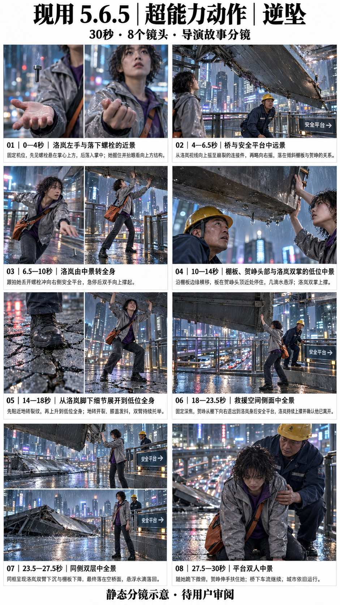</a><br/><strong>测试时默认 5.6.5</strong></td>
<td width="33%" valign="top"><a href="docs/research/skill-overhaul/seven-genres/images/07-superpower-a.png">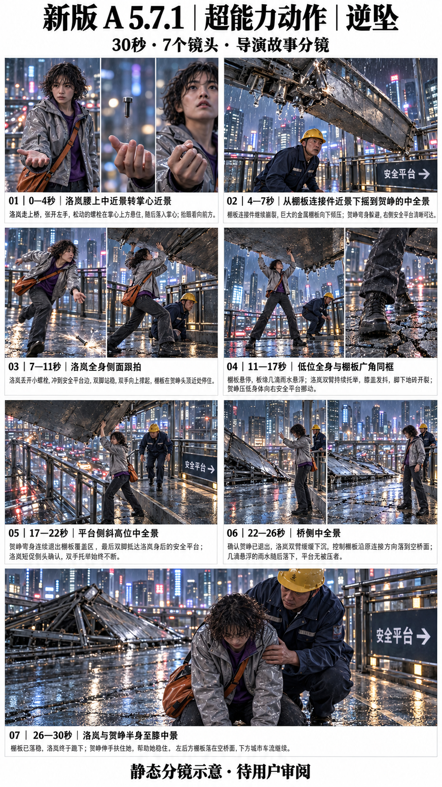</a><br/><strong>A 5.7.1</strong></td>
<td width="33%" valign="top"><a href="docs/research/skill-overhaul/seven-genres/images/07-superpower-b.png">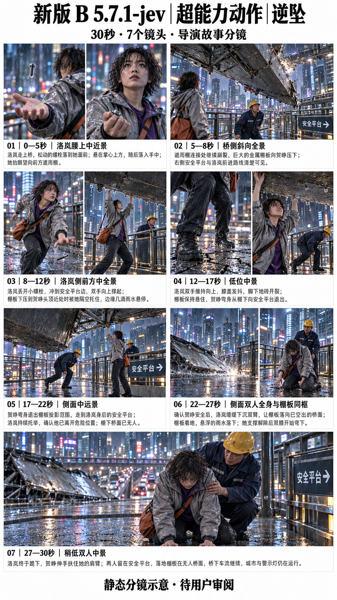</a><br/><strong>B 5.7.1-jev</strong></td>
</tr>
</table>

这些图片使用统一图像模型；A/B参照同题基准图的人物与场景外观，仍可能继承图像模型的姿态、构图或错误。本轮不构成严格盲测，不按镜数、术语量、问题条数或记录耗时给技能排名；静图也不能证明实际运镜和完整动作已执行。

### 同题融合与文字复核

《修表铺外》把5.6.5的交接细节、A的仰摇与观察方式放进同一方案。用户已明确选择末镜直接看男子本人走进巷口；这个具体选择不等于其余融合方案或整套技能都通过。研究保留旧版、A、局部修订、融合图与对应文字。

<a href="docs/research/skill-overhaul/fusion/fusion-storyboard.png">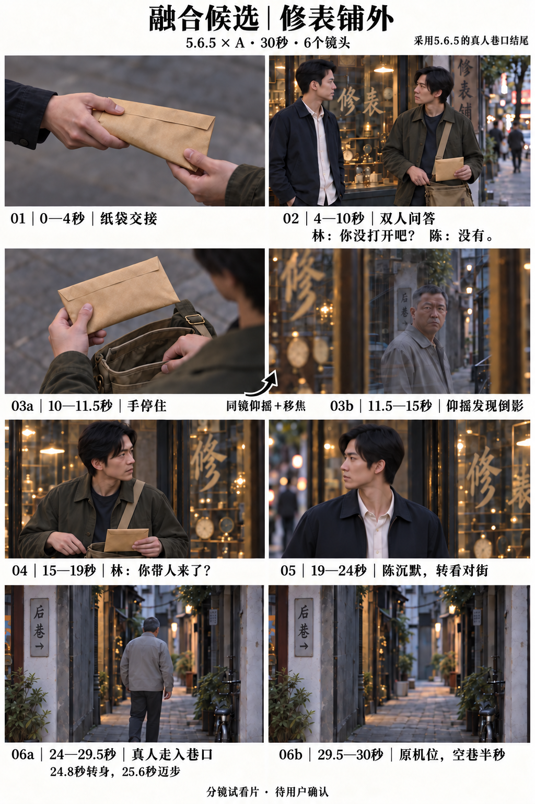</a>

[看完整融合过程、原稿、图片与文字复核](docs/research/skill-overhaul/fusion/index.md) · [查看全部整改研究](docs/research/skill-overhaul/index.md)

A/B共用创作核心。A由当前主模型检查，B可选增加Jev对明确文字要求的核对；Jev本轮没有接收图片像素或连续视频。文字核对结果和逐图检查分别记录。


</details>

<details>
<summary>展开视觉与制作研究：风格、古风、白模与实际生成对照</summary>

### 视觉风格、古风和白模研究

历史研究包含26张原创候选图、7组视频展示（8个完整MP4）和3份可编辑白模工程。下面按它们解决的视觉与制作问题展示；研究候选、已接受单幅作品、实际视频与有限预演各自保留原来的证据范围。

[研究结论与后续问题](docs/RESEARCH.md) · [全部研究图与提示词](docs/research/visual/index.md) · [全部白模与生成对照](docs/research/whitebox/index.md)

#### 3D 白模：动作重排与多镜切换

<table>
<tr>
<td width="50%" valign="top"><a href="docs/research/whitebox/action-reblock-30s.mp4">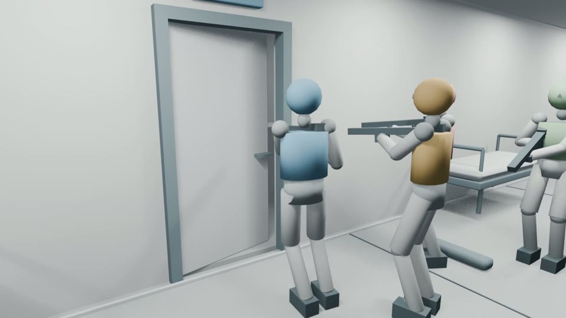</a><br/><strong>动作重排 · 30 秒 · 9/19</strong><br/>重新安排脚步、转身、手势与队伍展开，检查它们和连续运镜是否接得上。<br/><a href="docs/research/whitebox/action-reblock-30s.mp4">观看完整 MP4</a></td>
<td width="50%" valign="top"><a href="docs/research/whitebox/minimal-shots-30s.mp4">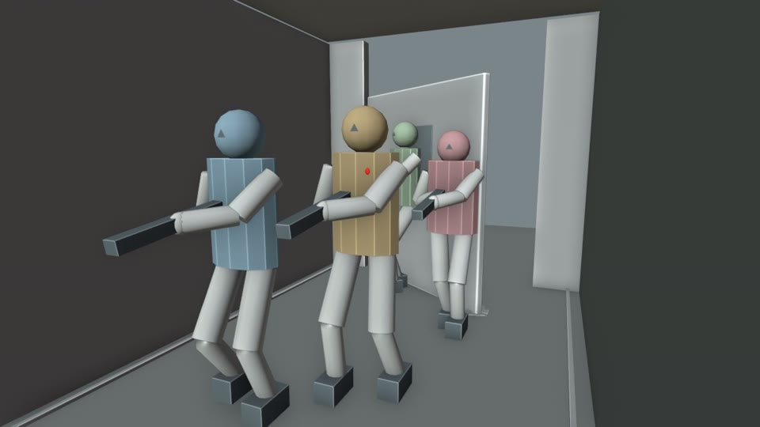</a><br/><strong>极简分镜 · 30 秒 / 11 镜 · 9/18</strong><br/>用必要的代理形体检查站位、视线、走位、切镜和注意力变化。<br/><a href="docs/research/whitebox/minimal-shots-30s.mp4">观看完整 MP4</a></td>
</tr>
</table>

两条均为历史研究候选；首页使用静态封面，点击观看完整MP4。它们展示简化关节代理和摄影实验，动作与审美仍待审；不证明最终 AI 成片。20 秒早期失败实验也保留在[研究演进页](docs/research/whitebox/index.md)。

#### 从白模到生成片：看哪里继承、哪里偏离

https://github.com/user-attachments/assets/951b5ff1-86e0-4629-b6cc-c3e3d915c9e0

赛车案例把原白模与实际生成片上下对照，并配中文讲解。**原设计为 15 秒，生成时误选约 30 秒**；12.5–27.375 秒没有对应的原白模镜头，保留完整结果供检查。[完整视频、对应关系与许可说明](docs/research/whitebox/index.md)

<details>
<summary>展开观看三组完整原白模：追逐、博弈、棍术</summary>

**高速追击 · 15 秒 / 6 镜**

https://github.com/user-attachments/assets/7bbea66b-d855-47c4-a7b0-b628bbd7d208

**权力博弈 · 30 秒 / 8 镜**

https://github.com/user-attachments/assets/be73270a-9cea-49a4-b421-39b2ea15abd8

**棍术打戏 · 15 秒 / 7 镜**

https://github.com/user-attachments/assets/fef933aa-eee3-40b9-8930-feb019b4e507

[每组完整 MP4、参考图和实际提示词](docs/research/whitebox/index.md) · [可运行案例与交互预演台](https://github.com/62656456/ai-visual-previs-lab)

</details>

#### 六种视觉风格：人物、环境和材质共同变化

<table>
<tr>
<td width="33%" valign="top"><a href="docs/research/visual/originals/style-film-realism.png"></a><br/><strong>胶片诗意写实</strong></td>
<td width="33%" valign="top"><a href="docs/research/visual/originals/style-mineral-painting.png"></a><br/><strong>东方岩彩</strong></td>
<td width="33%" valign="top"><a href="docs/research/visual/originals/style-copperplate-etching.png">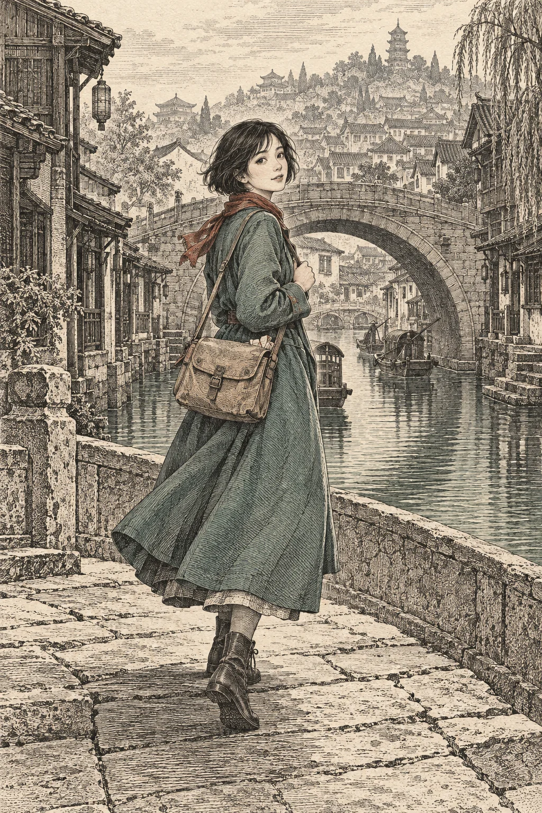</a><br/><strong>铜版线刻</strong></td>
</tr>
<tr>
<td width="33%" valign="top"><a href="docs/research/visual/originals/style-paper-theatre.png"></a><br/><strong>纸雕剧场</strong></td>
<td width="33%" valign="top"><a href="docs/research/visual/originals/style-needle-felt-v2.png"></a><br/><strong>羊毛毡定格感 · v2</strong></td>
<td width="33%" valign="top"><a href="docs/research/visual/originals/style-glazed-porcelain.png"></a><br/><strong>釉彩瓷偶</strong></td>
</tr>
</table>

胶片诗意写实、东方岩彩、铜版线刻、纸雕剧场、羊毛毡定格感与釉彩瓷偶，围绕相近题材进行探索。研究得到的具体方法是：风格规则必须覆盖人物和环境；羊毛毡版本针对水面进行了单独修订，避免真实液体与纤维世界混杂。六图为静态研究候选。[完整图、可复制提示词与风格规则](docs/research/visual/index.md)

#### 古风真实感：让人物与环境处在同一束光里

<table>
<tr>
<td width="33%" valign="top"><a href="docs/research/visual/originals/guofeng-window-letter.png"></a><br/><strong>窗边家书 · 窗光</strong></td>
<td width="33%" valign="top"><a href="docs/research/visual/originals/guofeng-seedling-handoff.png"></a><br/><strong>田埂递秧 · 阴天</strong></td>
<td width="33%" valign="top"><a href="docs/research/visual/originals/guofeng-market-eaves.png">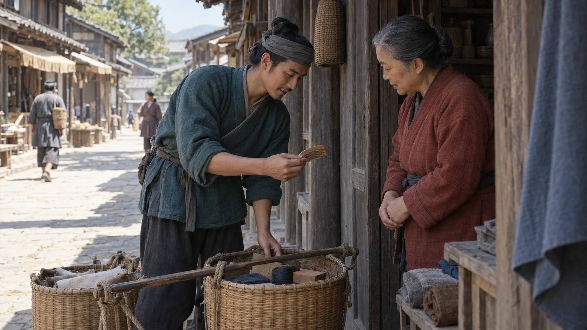</a><br/><strong>檐下挑货 · 光影交界</strong></td>
</tr>
</table>

从“色彩与故事感成立、真实感不足”的六朝首图出发，继续修订肤色、照明与材质，再以窗边家书、田埂递秧、檐下挑货验证新的生活场景。新图仍待审阅。[六朝原图→修订对照与三张新场景](docs/research/visual/index.md) · [古风技能 0.1.1 候选源码](experimental/guofeng-visual-director/SKILL.md)


</details>

### 可直接播放的基础预演证据

历史预演证据展示了可观看的机位、走位与短动作门，保留原验收范围：

<table>
<tr>
<td width="50%" valign="top"><a href="https://62656456.github.io/ai-film-skills/media/previs-blocking-5s.mp4">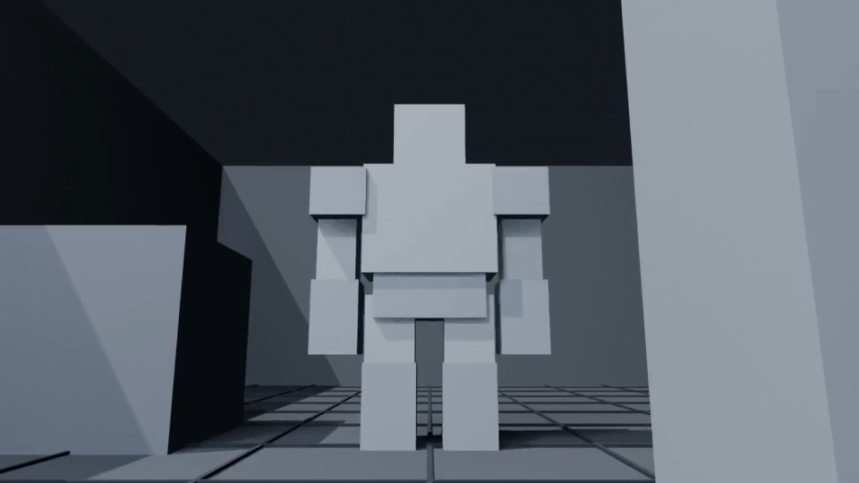</a><br /><strong>基础机位与走位 · 5秒</strong></td>
<td width="50%" valign="top"><a href="https://62656456.github.io/ai-film-skills/media/rigged-contact-gate-2.8s.mp4">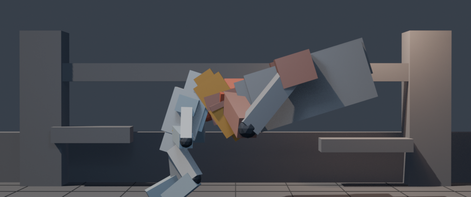</a><br /><strong>骨骼接触动作门 · 2.8秒</strong></td>
</tr>
</table>

白模执行器现作为源码中的独立实验包列出；这些历史片段证明有限预演与动作门，不证明任意完整打斗、最终AI成片或新的用户接受。[媒体清单](docs/media/media-manifest.json)

[旧5.4.4文字行为案例](examples/storyboard-director-5.4.4-visible-camera-plan.md)和[历史视觉参考墙](docs/style-gallery/manifest.json)仍可查看，保留各自日期与原状态，不与历史21张接受视觉成果混记。


<details>
<summary>查看历史工作流与三版关系图</summary>

以下图像保留研究时的 A/B 版本和原始标签；当前职责和配合关系以上面的技能介绍与流程为准。

<a href="docs/research/skill-overhaul/workflows/active-a.svg">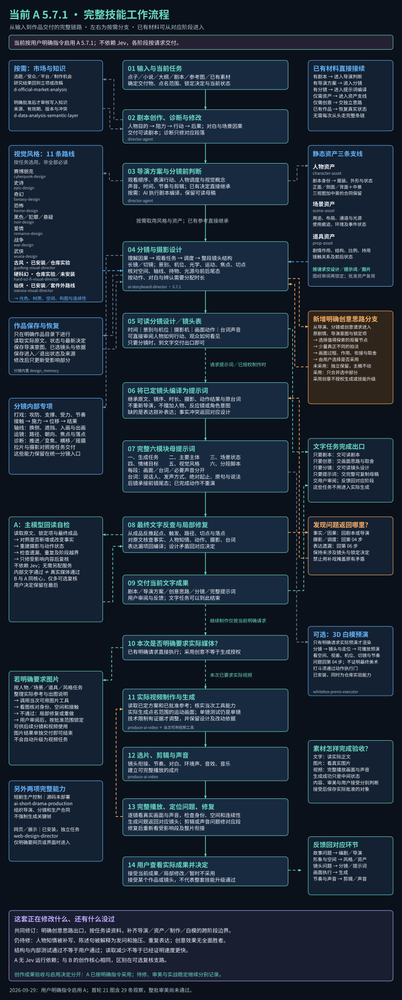</a>

[历史工作流与三版关系](docs/research/skill-overhaul/workflows/index.md) · [并排总图](docs/research/skill-overhaul/workflows/compare-all.svg)

</details>

<a id="install"></a>
<a id="开始使用当前源码中的一个skill"></a>

## 安装与调用：先选一个当前需要的技能

### 安装当前源码

```bash
git clone https://github.com/62656456/ai-film-skills.git
cd ai-film-skills
python scripts/install_skill.py --list
python scripts/install_skill.py director-agent --platform codex
```

把最后一行的 `director-agent` 换成上方需要的技能名。安装器支持 `codex`、`claude-code`、`trae`、`codebuddy`；也可使用 `--target` 指定项目目录。实验包需要额外明确选择，例如：

```bash
python scripts/install_skill.py hard-sci-fi-visual-director --platform codex --experimental
```

也可以使用 Skills CLI 发现仓库中的技能：

```bash
npx --yes skills@latest add 62656456/ai-film-skills --list
npx --yes skills@latest add 62656456/ai-film-skills --skill ai-storyboard-director --agent codex --copy --yes
```

[完整安装说明](docs/INSTALLATION.md) · [宿主兼容与实际验证范围](docs/COMPATIBILITY.md) · [42份中英指南](docs/skills/INDEX.md)

### 三种常见起点

**从故事开始：**

```text
使用 $director-agent，把下面的故事写成可读剧本。
保留已确认的人物、情节与结局，重点写清行动、对白和场景因果。
本次先交剧本；有需要澄清的事实就明确标出。
[粘贴故事与已有要求]
```

**从资产开始：**

```text
使用 $scene-asset，为下面的场景设计主图和一张独立反打。
保持同一空间布局、出入口、光源和物件状态。
本次先交完整图像提示词与空间说明。
[粘贴剧情、场景信息与已有参考]
```

**从已定导演方案开始：**

```text
使用 $ai-storyboard-director，根据下面的剧本与导演方案编排30秒分镜。
保留原动作、台词、空间和结局，写清时间、机位、摄影、画面和声音。
本次只要可读分镜；另有拍法思路时单列作用和取舍。
[粘贴剧本、导演方案与锁定项]
```

需要提示词时，再请求把已选分镜编译为完整母提示词；明确要实际视频或3D预演时，再进入对应制作。宿主能否自动发现、加载和调用技能，以实际安装与运行结果为准。

<a id="evidence"></a>

## 当前能确认什么

| 结果类型 | 可以说明什么 | 继续怎样检查 |
|---|---|---|
| 技能源码与程序检查 | 运行文件、引用、保存恢复和相关程序行为已按记录检查 | 在实际宿主中运行对应任务 |
| 文字方案与提示词 | 能检查剧情锁定、观看组织、摄影过程和编译保全 | 用实际图像或连续视频检查执行 |
| 已接受的静帧与界面 | 只对应那一张图或那次界面交付的接受记录 | 新版本、新画面和新任务分别审阅 |
| 分镜板与视觉研究 | 公开创作选择、已有问题和修订过程 | 待审与待修项按原记录继续处理 |
| 白模与动作门 | 只证明相应规格的机位、走位或短动作结果 | 新动作须先实现并通过对应检查 |
| 实际视频 | 需要完整播放检查动作、声音、连续性和结果 | 返修后再审，由用户决定是否接受 |

常规与实验是分发类别。安装成功、文字成立、媒体执行和用户接受分别记录；市场分析保留来源和日期，知识写入需要明确批准。短剧控制包的实际视频效果尚待验证；FCML机制库的实际模型效果未由程序检查替代。白模需要兼容运行环境，新打斗规格不能借用旧动作门的通过状态。

[研究总览](docs/RESEARCH.md) · [共同审核逻辑](docs/SKILL_DESIGN_SYSTEM.md) · [历史CLI验证](examples/skills-cli-install-verification.md) · [skills.sh目录](https://skills.sh/62656456/ai-film-skills)

<a id="english-overview"></a>

## English overview

Open Film Skills is a repository of **21 independent Agent Skills: 18 regular and 3 experimental**, with 42 English/Simplified Chinese guides. It covers screenplay writing and directing, reusable character/scene/prop assets, eight genre visual routes, cinematography and prompts, actual video production, short-drama control, market research, approved knowledge updates, web interfaces, hard science fiction, guofeng and bounded 3D previs.

Choose a Skill by the task and deliverable listed above. Existing approved decisions pass to the next stage. Current Storyboard Director source is **5.8.3**; the frozen **v1.4.0** archive still contains **5.7.2**. Native host support, actual media execution and user acceptance are verified separately. External xianxia is linked upstream and is not part of the 21 redistributed packages.

[English guides](docs/skills/INDEX.md) · [Installation](docs/INSTALLATION.md) · [Source catalog](SKILL_CATALOG.md)

## 许可、来源与参与

原创技能、脚本、文档、提示词和明确授权的原创示例按仓库许可及各自来源说明使用。第三方参考和外部上游保留各自许可与范围；私人项目、账户凭证和本机状态不进入公开资料。

[Apache License 2.0](LICENSE) · [原创版权与商用](COMMERCIAL_USE.md) · [第三方说明](THIRD_PARTY_NOTICES.md) · [公开范围](PUBLICATION_SCOPE.md) · [贡献说明](CONTRIBUTING.md) · [安全反馈](SECURITY.md) · [讨论](https://github.com/62656456/ai-film-skills/discussions) · [问题反馈](https://github.com/62656456/ai-film-skills/issues)

<a id="updates"></a>

## 版本更新与历史下载

### 2026-10-15 · GitHub首页介绍全面重整

本次按整个仓库重写README：前置21个技能的适用任务和直接交付，补齐阶段交接与三种调用示例；完整作品与研究重新分组，保留原图、视频和验收状态。当前介绍由本仓库首页直接承载。

### 2026-10-14 · 分镜导演5.8.3与导演Agent同步

以完整5.7.7为基础，合入5.8.2的FCML离线镜头库、观看距离与起中终画框设计、可选设计保存和编译保全。原电影摄影、四种速度、真实光影、对招、持物、共同空间及格式规则保留；导演Agent的场景交接、观看方案比较和编译复核同步。

[合并、检查与版本保全记录](docs/maintenance/2026-10-14-director-5.8.3-merge.md) · [Git中的完整5.7.7回退快照](https://github.com/62656456/ai-film-skills/tree/781f0aa5eff3c40f759d96d954ced42222e8ce56/skills/ai-storyboard-director)

| 获取入口 | 实际版本与用途 |
|---|---|
| [当前仓库源码](skills/ai-storyboard-director/SKILL.md) | 分镜导演 **5.8.3**；其他包以实际源码和声明的版本为准。当前安装使用检出的源码 |
| [v1.4.0历史冻结下载](https://github.com/62656456/ai-film-skills/releases/tag/v1.4.0) | 分镜 **5.7.2**；21个单包与18常规包套装。旧归档不随当前源码更新 |
| [v1.3.0历史下载](https://github.com/62656456/ai-film-skills/releases/tag/v1.3.0) | 分镜 **5.4.4**及旧清单，旧案例保留 `SELF-AUDIT ONLY` 原标识 |
| 5.6独立Preview | 单独标记的历史预览物，按其自身清单和范围使用，见[版本说明](docs/INSTALLATION.md) |

<details>
<summary>展开先前版本、维护与研究记录</summary>

2026-09-29明确启用A后，可读分镜、视频提示词和实际媒体按请求分别执行；创意思路采用后才并入主方案。三版工作流、同题原稿与融合、七题材21张首轮图、生成说明与逐图问题继续可查。测试图中的“现用5.6.5”指实验开始时的默认版本，保留原标签。B5.7.1-jev为历史可选文字复核，不接管图像审美或创意采用。

历史记录包括21包结构核对、6项仓库质量门和168项回归（164通过、4跳过），以及独立前向文本试用。这些数字只对应当时的执行范围与日期，见[整改研究](docs/research/skill-overhaul/index.md)；本轮检查见5.8.3合并记录。

2026-10-09维护记录保留33条历史评审、23条仍适用问题的处理；5.8.0来源整合、5.8.1观看方案与5.8.2成像整改保留各自原文、同题重跑和验证边界。此前21张已接受作品、9月视觉研究、白模实验与旧版本案例继续按各自原始状态保留。

[10月9日维护](docs/maintenance/2026-10-09-review-closure.md) · [5.8.0来源整合](docs/maintenance/2026-10-10-cinematic-fcml-upgrade.md) · [5.8.1观看方案](docs/maintenance/2026-10-10-substantive-cinematic-revision.md) · [5.8.2色调与成像](docs/maintenance/2026-10-10-image-formation-revision.md)

[A/B检查方式与边界](docs/SEMANTIC_REVIEW.md) · [检查、启用和回退方法](docs/RELEASE_WORKFLOW.md) · [七题材逐图问题与待修](docs/research/skill-overhaul/seven-genres/index.md)

</details>
